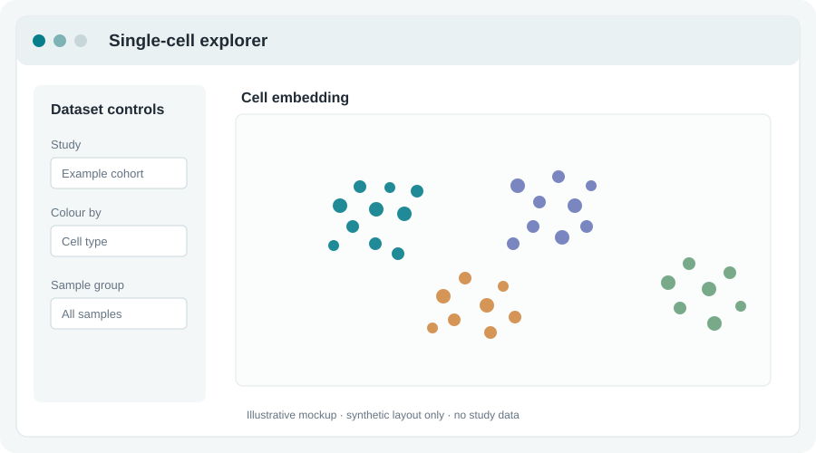
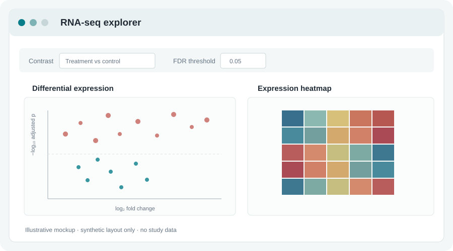
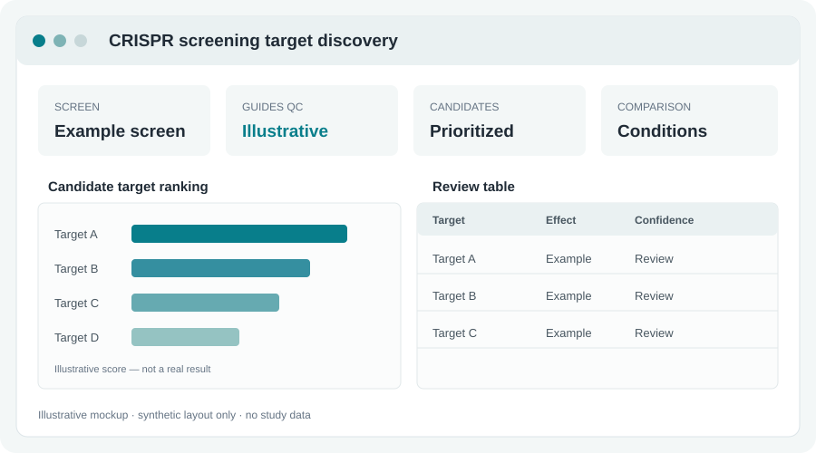

<nav class="cv-nav" aria-label="CV sections">
  <a href="#overview">Overview</a>
  <a href="#employment">Employment</a>
  <a href="#education">Education</a>
  <a href="#portfolio">Research</a>
  <a href="#digital-tools">Digital tools</a>
  <a href="#publications">Publications</a>
</nav>

::: {.cv-hero}
::: {.cv-hero-copy}

Translational Medicine · Immuno-oncology · Bioinformatics

# Nelson Kibinge, PhD

I turn patient and pre-clinical data into actionable insight for oncology drug discovery from indication selection and biomarker discovery to AI-enabled target prioritization.

<a href="https://www.linkedin.com/in/nelson-kibinge-1b1477223/">LinkedIn</a><a href="https://scholar.google.com/citations?user=0aNS07IAAAAJ&amp;hl=en&amp;oi=ao">Google Scholar</a><a href="https://github.com/nelkibs">GitHub</a><a href="mailto:nelkibs@gmail.com">Email</a>

:::

::: {.cv-hero-photo}

:::
:::

::: {.cv-content}

## Overview {#overview}

Computational biologist and senior scientist at [Orion Pharma](https://www.orionpharma.com/) in Translational Medicine, supporting oncology research across pre-clinical and clinical programmes. Recent work focuses on immuno-oncology, translational bioinformatics, and using patient molecular data to inform therapeutic development.

::: {.overview-focus}
### Current focus and capabilities

- Support clinical indication selection and translational decisions by integrating disease biology with clinical and molecular evidence.
- Discover and assess biomarker hypotheses using patient DNA-seq, ctDNA, and RNA-seq, including immune and tumour-related features.
- Develop R and Python tools and Shiny applications; apply AI-driven approaches to oncology target discovery and prioritization.
- Bring expertise in multi-omics, single-cell and spatial analysis, and cross-functional collaboration across translational, clinical, and research teams.
:::

Earlier work spans statistical genomics at the University of Bristol and infectious-disease genomics at the KEMRI-Wellcome Trust Research Programme. He also holds an Adjunct Faculty position at Pwani University, Kenya.

## Career overview {#career-overview}

::: {.career-timeline}
::: {.milestone}
{.institution-logo}
2008
<strong>BSc in Biology</strong>
University of Nairobi
:::

::: {.milestone}
{.institution-logo}
2011
<strong>MSc studies</strong>
Nara Institute of Science and Technology
:::

::: {.milestone}
{.institution-logo}
2013–2015
<strong>PhD studies</strong>
Nara Institute of Science and Technology
:::

::: {.milestone}
{.institution-logo}
2016–2019
<strong>Postdoctoral research</strong>
KEMRI-Wellcome Trust Research Programme
:::

::: {.milestone}
{.institution-logo}
2019–2020
<strong>Statistical genomics</strong>
University of Bristol
:::

::: {.milestone}
{.institution-logo}
2020–Present
<strong>Senior Scientist</strong>
Orion Pharma
:::
:::

## Employment & experience {#employment}

::: {.experience}
::: {.experience-date}
Feb 2020 – Present Turku, Finland
:::
::: {.experience-detail}
### Senior Scientist – Computational Biologist
**Orion Pharma**

Supports Translational Medicine and oncology research and development across pre-clinical and clinical projects. Develops and applies computational approaches to high-throughput omics data, contributes to drug-target prioritization and biomarker discovery, and collaborates with academic groups on data-driven bioinformatics and AI.
:::
:::

::: {.experience}
::: {.experience-date}
Apr 2019 – Jan 2020 Bristol, United Kingdom
:::
::: {.experience-detail}
### Senior Research Associate – Statistical Genomics
**MRC Integrative Epidemiology Unit, University of Bristol**

Applied genomics and epidemiology methods to identify therapeutic targets for autoimmune diseases, communicated scientific findings, and facilitated academic–pharma collaboration.
:::
:::

::: {.experience}
::: {.experience-date}
Jan 2019 – Mar 2019 Heidelberg, Germany
:::
::: {.experience-detail}
### Visiting Research Scientist
**Heidelberg University**

Developed statistical methods for analysis of KILchip Protein Microarray data.
:::
:::

::: {.experience}
::: {.experience-date}
Mar 2018 – Jun 2019 Kilifi, Kenya
:::
::: {.experience-detail}
### Senior Postdoctoral Scientist – Acting Head of Statistics
**KEMRI-Wellcome Trust Research Programme**

Led the statistics unit, supported institutional statistical needs, and developed statistical methods for diverse omics datasets.
:::
:::

::: {.experience}
::: {.experience-date}
Mar 2016 – Nov 2018 Kilifi, Kenya
:::
::: {.experience-detail}
### Early Career Postdoctoral Scientist
**KEMRI-Wellcome Trust Research Programme**

Conducted research on malaria and virus genomics and diversity in long-term surveillance; wrote and published research; and supervised master’s students and interns.
:::
:::

::: {.experience}
::: {.experience-date}
Jul 2016 – Present Kilifi, Kenya
:::
::: {.experience-detail}
### Adjunct Faculty
**Pwani University**

Taught MSc Bioinformatics courses in biostatistics, data science for biology, databases, and data visualization; examines master’s and doctoral theses in bioinformatics.
:::
:::

::: {.experience}
::: {.experience-date}
Mar 2015 – Sep 2015 Niigata, Japan
:::
::: {.experience-detail}
### Bioinformatics Intern
**Yukiguni Maitake**

Developed transcriptomics and genomics software tools supporting research and development in Maitake mushroom cultivation.
:::
:::

::: {.experience}
::: {.experience-date}
2008 – 2009 Kenya
:::
::: {.experience-detail}
### Medical Sales Representative
**Pharmaken Kenya Ltd.**

Marketed generic anti-inflammatory and analgesic products in Nairobi and the North Eastern region.
:::
:::

## Education {#education}

::: {.education-list}
::: {.education-entry}

2013–2015

### PhD in Computational Biology
**Nara Institute of Science and Technology (NAIST)**

View doctoral thesis

*Integrated pathway-based transcription regulation network mining to decipher the role of transcription factors in the heterogeneity of small cell lung cancer phenotypes.*

:::

::: {.education-entry}

2011–2013

### MSc in Computational Biology
**Nara Institute of Science and Technology (NAIST)**

View master's thesis

*Protein sequence diversity characterization using the physical attributes of amino acids: Examples in Plasmodium falciparum sequences and terpenoid enzymes.*

:::

::: {.education-entry}

2010–2011

### Intensive Japanese Language Course
**Osaka University**

:::

::: {.education-entry}

2004–2008

### BSc in Biology
**University of Nairobi**

:::

::: {.education-entry}

1999–2002

### Secondary Education
**St Patrick’s High School, Iten**

:::
:::

## Research & technical areas {#portfolio}

::: {.research-grid}
::: {.research-card}
### Translational oncology bioinformatics

**Current focus — Translational Medicine, Orion Pharma**

- Support pre-clinical and clinical oncology programmes, with recent work primarily in immuno-oncology bioinformatics.
- Support clinical-project indication selection by integrating available molecular and clinical evidence to characterize disease biology, patient subgroups, and translational rationale.
- Integrate genomic, transcriptomic, proteomic, single-cell, and spatial data to characterize tumour and immune biology and generate testable hypotheses.
- Contribute computational evidence for target discovery and validation, target confidence, biomarker development, and patient stratification.
- Translate analyses into clear evidence and decision support for multidisciplinary project teams.
:::

::: {.research-card}
### Immuno-oncology bioinformatics

- Analyze molecular and high-throughput data to investigate tumour–immune interactions and the tumour microenvironment.
- Support characterization of immune-cell populations, immune-related molecular signatures, and variation across tumour samples or patient groups.
- Connect pre-clinical and clinical evidence to translational questions around target biology, biomarkers, and patient stratification.
- Apply single-cell and spatial approaches where data are available to add cellular and tissue context to oncology findings.
- Discover and evaluate biomarker hypotheses using patient DNA sequencing, circulating tumour DNA (ctDNA), and RNA sequencing data, applying fit-for-purpose contemporary computational and statistical methods.
- Support multi-modal interpretation of patient-derived data, including somatic variant and genomic feature characterization, RNA expression signatures, and longitudinal ctDNA signal assessment when relevant to study design and data availability.
- Contribute to immuno-oncology target research, including work on CBL-B in tumour-infiltrating immune cells, presented at AACR 2025.
:::

::: {.research-card}
### Core competencies

- **Translational medicine:** connect discovery and clinical evidence; frame answerable questions; interpret findings in biological and programme context.
- **Omics and bioinformatics:** high-throughput data analysis across genomics, transcriptomics, proteomics, and single-cell and spatial modalities.
- **Immuno-oncology:** tumour–immune biology, immune-cell profiling, tumour-infiltrating immune cells, and immune-related signatures.
- **Biomarkers and precision oncology:** support biomarker hypotheses, molecular subgroups, and patient-selection strategies.
- **Statistical genomics:** GWAS, genetic epidemiology, Mendelian randomization, and proteomic-data analysis.
:::

::: {.research-card}
### Modern pharmaceutical data science

- **R and Python tool development:** develop analytical tools, reusable workflows, and data-science applications to support research and development questions, omics analysis, and scientific decision-making.
- **AI-driven drug discovery:** apply AI and machine-learning approaches to support oncology target discovery and prioritization, target-confidence assessment, and data-driven hypothesis generation.
- **Reproducible analytics:** build fit-for-purpose, documented workflows with attention to data provenance, quality, and reviewability.
- **Evidence-aware interpretation:** account for study design, cohort composition, data limitations, and uncertainty; distinguish exploratory signals from validated findings.
- **Cross-functional delivery:** collaborate with clinical, translational, computational, and experimental colleagues; communicate results for both technical and non-technical audiences.
- **Responsible use of advanced methods:** select methods appropriate to the question and data, with transparent assumptions and suitable validation.
:::

::: {.research-card}
### Broader research experience

- Statistical genomics and genetic epidemiology for therapeutic target prioritization.
- Malaria and viral genomics, long-term surveillance, host immunity, and infectious-disease research.
- Bioinformatics across genomics, transcriptomics, and proteomics, with experience communicating and publishing collaborative research.
:::
:::

## Selected publications {#publications}

::: {.publication}
**Abstract 914: Differential expression of Cbl-b in tumor infiltrating immune cells in patients with solid tumors.** Elli Narvi, Reetta Virtakoivu, Endrit Elbasani, **Nelson Kibinge**, Laura Ravanti, and Anil K. Thotakura (2025). *Cancer Research*, 85(8 Supplement 1), 914. Presented at the American Association for Cancer Research (AACR) Annual Meeting. [Abstract](https://aacrjournals.org/cancerres/article/85/8_Supplement_1/914/754713/Abstract-914-Differential-expression-of-Cbl-b-in) · [DOI](https://doi.org/10.1158/1538-7445.am2025-914)
:::

::: {.publication}
**Correlation of laboratory safety variables with disease course in the REFALS phase 3 study of levosimendan in people with ALS (4125).** Nelson Kibinge, Alex Dickens, Angela Genge, Nicholas Maragakis, Susanne Petri, Leonard Van den Berg, Ammar Al-Chalabi, Valtteri Aho, Kira Holmström, and Merit Cudkowicz (2021). *Neurology*, 96(15 supplement), 4125. [Abstract](https://www.neurology.org/doi/abs/10.1212/WNL.96.15_supplement.4125)
:::

::: {.publication}
**Characterizing the causal pathway for genetic variants associated with neurological phenotypes using human brain-derived proteome data.** **Nelson K. Kibinge**, Caroline L. Relton, Tom R. Gaunt, and Tom G. Richardson (2020). *The American Journal of Human Genetics*, 106(6), 885–892. [Article](https://www.cell.com/ajhg/fulltext/S0002-9297%2820%2930116-6) · [Google Scholar](https://scholar.google.com/citations?view_op=view_citation&user=0aNS07IAAAAJ&citation_for_view=0aNS07IAAAAJ:4TOpqqG69KYC)
:::

::: {.publication}
**Integrated pathway-based transcription regulation network mining and visualization based on gene expression profiles.** **Nelson Kibinge**, N. Ono, M. Horie, T. Sato, T. Sugiura, M. Altaf-Ul-Amin, et al. (2016). *Journal of Biomedical Informatics*, 61, 194–202. [Google Scholar](https://scholar.google.com/citations?view_op=view_citation&user=0aNS07IAAAAJ&citation_for_view=0aNS07IAAAAJ:qjMakFHDy7sC)
:::

Expand to view other Google Scholar records

- **Biomarkers of post-discharge mortality among children with complicated severe acute malnutrition.** J. M. Njunge, A. Gwela, **N. K. Kibinge**, et al. (2019). *Scientific Reports*, 9, 5981. [Scholar](https://scholar.google.com/citations?view_op=view_citation&user=0aNS07IAAAAJ&citation_for_view=0aNS07IAAAAJ:0EnyYjriUFMC)
- **Data mining methods for omics and knowledge of crude medicinal plants toward big data biology.** F. M. Afendi, N. Ono, Y. Nakamura, K. Nakamura, L. K. Darusman, **N. Kibinge**, et al. (2014). [Scholar](https://scholar.google.com/citations?view_op=view_citation&user=0aNS07IAAAAJ&citation_for_view=0aNS07IAAAAJ:u-x6o8ySG0sC)
- **Controlled Human Malaria Infection in Semi-Immune Kenyan Adults (CHMI-SIKA): a study protocol to investigate in vivo *Plasmodium falciparum* malaria parasite growth in the context of pre-existing immunity.** M. C. Kapulu, P. Njuguna, M. M. Hamaluba, CHMI-SIKA Study Team (2019). *Wellcome Open Research*, 3, 155. [Article](https://pmc.ncbi.nlm.nih.gov/articles/PMC6871356/) · [Scholar](https://scholar.google.com/citations?view_op=view_citation&user=0aNS07IAAAAJ&citation_for_view=0aNS07IAAAAJ:KlAtU1dfN6UC)
- **Controlled Human Malaria Infection in Semi-Immune Kenyan Adults (CHMI-SIKA): a study protocol…** M. C. Kapulu, P. Njuguna, M. M. Hamaluba, CHMI-SIKA Study Team (2019). Additional Google Scholar record for the protocol. [Scholar](https://scholar.google.com/citations?view_op=view_citation&user=0aNS07IAAAAJ&citation_for_view=0aNS07IAAAAJ:Zph67rFs4hoC)
- **KILchip v1.0: A novel *Plasmodium falciparum* merozoite protein microarray to facilitate malaria vaccine candidate prioritization.** G. Kamuyu, J. Tuju, R. Kimathi, K. Mwai, J. Mburu, **N. Kibinge**, et al. (2018). *Frontiers in Immunology*, 9, 2866. [Article](https://www.frontiersin.org/journals/immunology/articles/10.3389/fimmu.2018.02866/full) · [Scholar](https://scholar.google.com/citations?view_op=view_citation&user=0aNS07IAAAAJ&citation_for_view=0aNS07IAAAAJ:UebtZRa9Y70C)
- **Anti-merozoite antibodies induce natural killer cell effector function and are associated with immunity against malaria.** D. Odera, J. Tuju, K. Mwai, et al., including **N. Kibinge** (2023). *Science Translational Medicine*, 15(682), eabn5993. [Article](https://www.science.org/doi/abs/10.1126/scitranslmed.abn5993) · [Scholar](https://scholar.google.com/citations?view_op=view_citation&user=0aNS07IAAAAJ&citation_for_view=0aNS07IAAAAJ:ZeXyd9-uunAC)
- **Distinct kinetics of antibodies to 111 *Plasmodium falciparum* proteins identifies markers of recent malaria exposure.** V. Yman, J. Tuju, M. T. White, et al., including **N. Kibinge** (2022). *Nature Communications*, 13, 331. [Article](https://www.nature.com/articles/s41467-021-27863-8) · [Scholar](https://scholar.google.com/citations?view_op=view_citation&user=0aNS07IAAAAJ&citation_for_view=0aNS07IAAAAJ:L8Ckcad2t8MC)
- **Clustering of 3D-structure similarity based network of secondary metabolites reveals their relationships with biological activities.** Y. Ohtana, A. A. Abdullah, M. Altaf-Ul-Amin, et al. (2014). *Molecular Informatics*, 33(11–12), 790–801. [Scholar](https://scholar.google.com/citations?view_op=view_citation&user=0aNS07IAAAAJ&citation_for_view=0aNS07IAAAAJ:2osOgNQ5qMEC)
- **Molecular epidemiology of human rhinovirus from one-year surveillance within a school setting in rural coastal Kenya.** M. M. Luka, E. Kamau, I. Adema, et al., including **N. Kibinge** (2020). *Open Forum Infectious Diseases*, 7(10), ofaa385. [Article](https://academic.oup.com/ofid/article/7/10/ofaa385/5897788) · [Scholar](https://scholar.google.com/citations?view_op=view_citation&user=0aNS07IAAAAJ&citation_for_view=0aNS07IAAAAJ:YOwf2qJgpHMC)
- **Evaluating the performance of tools used to call minority variants from whole genome short-read data.** K. S. Mohammed, **N. Kibinge**, P. Prins, et al. (2018). *Wellcome Open Research*, 3, 21. [Scholar](https://scholar.google.com/citations?view_op=view_citation&user=0aNS07IAAAAJ&citation_for_view=0aNS07IAAAAJ:eQOLeE2rZwMC)
- **Evaluating the performance of tools used to call minority variants from whole genome short-read data** (version record). K. S. Mohammed, **N. Kibinge**, P. Prins, et al. (2018). [Scholar](https://scholar.google.com/citations?view_op=view_citation&user=0aNS07IAAAAJ&citation_for_view=0aNS07IAAAAJ:mB3voiENLucC)
- **Evaluating the performance of tools used to call minority variants from whole genome short-read data** (version record). K. S. Mohammed, **N. Kibinge**, P. Prins, et al. (2018). [Scholar](https://scholar.google.com/citations?view_op=view_citation&user=0aNS07IAAAAJ&citation_for_view=0aNS07IAAAAJ:mB3voiENLucC)
- **Systematization of the protein sequence diversity in enzymes related to secondary metabolic pathways in plants, in the context of big data biology inspired by the KNApSAcK database.** S. Ikeda, T. Abe, Y. Nakamura, **N. Kibinge**, et al. (2013). *Plant and Cell Physiology*, 54(5), 711–727. [Scholar](https://scholar.google.com/citations?view_op=view_citation&user=0aNS07IAAAAJ&citation_for_view=0aNS07IAAAAJ:u5HHmVD_uO8C)
- **Cerebrospinal fluid markers to distinguish bacterial meningitis from cerebral malaria in children.** J. M. Njunge, I. N. Oyaro, **N. K. Kibinge**, et al. (2017). *Wellcome Open Research*, 2, 47. [Scholar](https://scholar.google.com/citations?view_op=view_citation&user=0aNS07IAAAAJ&citation_for_view=0aNS07IAAAAJ:zYLM7Y9cAGgC)
- **Breadth of antibodies to *Plasmodium falciparum* variant surface antigens is associated with immunity in a controlled human malaria infection study.** H. W. Kimingi, A. W. Kinyua, N. A. Achieng, et al. (2022). *Frontiers in Immunology*, 13, 894770. [Scholar](https://scholar.google.com/citations?view_op=view_citation&user=0aNS07IAAAAJ&citation_for_view=0aNS07IAAAAJ:qUcmZB5y_30C)
- **Peripheral blood mononuclear cell transcriptomes reveal an over-representation of down-regulated genes associated with immunity in HIV-exposed uninfected infants.** Z. D. Musimbi, M. K. Rono, J. R. Otieno, **N. Kibinge**, et al. (2019). *Scientific Reports*, 9, 18124. [Article](https://www.nature.com/articles/s41598-019-54083-4) · [Scholar](https://scholar.google.com/citations?view_op=view_citation&user=0aNS07IAAAAJ&citation_for_view=0aNS07IAAAAJ:MXK_kJrjxJIC)
- **protGear: A protein microarray data pre-processing suite.** K. Mwai, **N. Kibinge**, J. Tuju, G. Kamuyu, R. Kimathi, J. Mburu, et al. (2021). *Computational and Structural Biotechnology Journal*. [Article](https://www.sciencedirect.com/science/article/pii/S2001037021001562) · [Scholar](https://scholar.google.com/citations?view_op=view_citation&user=0aNS07IAAAAJ&citation_for_view=0aNS07IAAAAJ:9ZlFYXVOiuMC)
- **Molecular epidemiology of human rhinovirus from one-year surveillance within a school setting in rural coastal Kenya.** E. Gicheru, A. Gichuki, D. J. Nokes, M. M. Luka, et al., including **N. Kibinge** (2020). [medRxiv](https://www.medrxiv.org/content/10.1101/2020.03.09.20033019v2) · [Scholar](https://scholar.google.com/citations?view_op=view_citation&user=0aNS07IAAAAJ&citation_for_view=0aNS07IAAAAJ:Wp0gIr-vW9MC)
- **In-silico immune cell deconvolution of the airway proteomes of infants with pneumonia reveals a link between reduced airway eosinophils and an increased risk of mortality.** C. J. Sande, J. M. Waeni, J. M. Njunge, et al., including **N. K. Kibinge** (2019). *bioRxiv*, 840090. [Scholar](https://scholar.google.com/citations?view_op=view_citation&user=0aNS07IAAAAJ&citation_for_view=0aNS07IAAAAJ:8k81kl-MbHgC)
- **Characterization of antibody kinetics in travellers with *Plasmodium falciparum* infection allows for identification of serological markers of cumulative and recent malaria exposure.** V. Yman, J. Tuju, M. T. White, et al., including **N. Kibinge** (2019). *American Journal of Tropical Medicine and Hygiene*, 101, 290. [Scholar](https://scholar.google.com/citations?view_op=view_citation&user=0aNS07IAAAAJ&citation_for_view=0aNS07IAAAAJ:kNdYIx-mwKoC)
- **Assessing the utility of minority variant composition in elucidating RSV transmission pathways.** G. Githinji, C. N. Agoti, **N. Kibinge**, et al. (2018). *bioRxiv*. [Scholar](https://scholar.google.com/citations?view_op=view_citation&user=0aNS07IAAAAJ&citation_for_view=0aNS07IAAAAJ:Se3iqnhoufwC)
- **Protein sequence modeling and transcription regulation network analysis towards integrative big data biology.** **N. K. Kibinge** (2016). Nara Institute of Science and Technology. [Scholar](https://scholar.google.com/citations?view_op=view_citation&user=0aNS07IAAAAJ&citation_for_view=0aNS07IAAAAJ:7PzlFSSx8tAC)
- **Plasmodium phylogenetics and numeric modification of amino acid residues.** **N. K. Kibinge** (2013). Nara Institute of Science and Technology. [Scholar](https://scholar.google.com/citations?view_op=view_citation&user=0aNS07IAAAAJ&citation_for_view=0aNS07IAAAAJ:hC7cP41nSMkC)
- **Integration of residue attributes for sequence diversity characterization of terpenoid enzymes.** **N. Kibinge**, S. Ikeda, N. Ono, M. Altaf-Ul-Amin, and S. Kanaya (2014). *BioMed Research International*, 2014, 753428. [Scholar](https://scholar.google.com/citations?view_op=view_citation&user=0aNS07IAAAAJ&citation_for_view=0aNS07IAAAAJ:9yKSN-GCB0IC)
- **Distinct kinetics in antibody responses to 111 *Plasmodium falciparum* antigens identifies novel serological markers of recent malaria exposure.** V. Yman, J. Tuju, M. T. White, et al., including **N. Kibinge** (2020). *medRxiv*. [Scholar](https://scholar.google.com/citations?view_op=view_citation&user=0aNS07IAAAAJ&citation_for_view=0aNS07IAAAAJ:4DMP91E08xMC)
- **RSV modelling meeting.** K. Atkins, M. Baguelin, S. Brand, et al., including **N. Kibinge** (2017). Meeting record, University of Warwick. [Scholar](https://scholar.google.com/citations?view_op=view_citation&user=0aNS07IAAAAJ&citation_for_view=0aNS07IAAAAJ:IWHjjKOFINEC)
- **Fall-risk classification of the timed up-and-go test with principal component analysis.** N. Tanaka, N. A. Zakaria, **N. K. Kibinge**, et al. (2014). *International Journal of Neurorehabilitation*, 1, e106. [Scholar](https://scholar.google.com/citations?view_op=view_citation&user=0aNS07IAAAAJ&citation_for_view=0aNS07IAAAAJ:d1gkVwhDpl0C)
- **The landscape of paediatric infectious disease exposure in a rural sub-Saharan Africa setting in Kilifi, Kenya: longitudinal serological analysis over two decades and priorities for future vaccine development.** D. F. Foley, T. K. Chege, J. Kabagenyi, et al., including **N. Kibinge** (2024). *medRxiv*. [Scholar record](https://scholar.google.com/citations?view_op=view_citation&user=0aNS07IAAAAJ&citation_for_view=0aNS07IAAAAJ:-f6ydRqryjwC)

*Google Scholar showed 30 article records and an additional “Show more” control. This archive reflects records retrievable at the time; Scholar may include preprints, meeting records, and duplicate/version entries. Check the live profile for completeness.*

## Digital tools & applications {#digital-tools}

Selected examples of Shiny-based bioinformatics applications developed for interactive exploration of omics and screening data. The images below are illustrative mockups, not screenshots of the live applications; they contain no real study data.

::: {.tool-grid}
::: {.tool-card}

### Single-cell explorer

Interactive exploration of single-cell datasets, with visual summaries to support review of cellular populations, marker patterns, and sample-level variation.

**Format:** Shiny-based application · **Image:** illustrative mockup
:::

::: {.tool-card}

### RNA-seq explorer

Interactive review of RNA-seq results, designed to help browse expression patterns, compare contrasts, and inspect candidate genes and pathway-level summaries.

**Format:** Shiny-based application · **Image:** illustrative mockup
:::

::: {.tool-card}

### CRISPR screening target-discovery app

Interactive analysis of CRISPR screening outputs to support screen review, prioritization of candidate targets, and follow-up investigation.

**Format:** Shiny-based application · **Image:** illustrative mockup
:::
:::

## Awards & achievements {#awards}

::: {.award}
2025
**Orion Innovation Award** — Development of an in-house oncology single-cell explorer platform, deployed in production for target discovery and ideation.
:::

::: {.award}
2010
**Monbukagakusho (MEXT) Scholarship** — Awarded to pursue master’s and doctoral studies in bioinformatics.
:::

::: {.award}
2008
**Gandhi Smarak Nidhi Fund Prize** — Top graduate student, School of Biological Sciences, University of Nairobi, Class of 2008.
:::

## Contact {#contact}

For professional inquiries, contact [nelkibs@gmail.com](mailto:nelkibs@gmail.com), or connect via [LinkedIn](https://www.linkedin.com/in/nelson-kibinge-1b1477223/) and [Google Scholar](https://scholar.google.com/citations?user=0aNS07IAAAAJ&hl=en&oi=ao).

:::

<footer class="cv-footer">Curriculum Vitae · Nelson Kibinge</footer>
